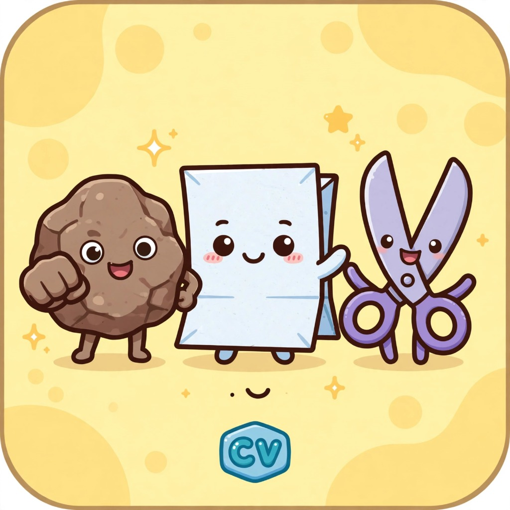

<div align="center">



# Vision RPS 2.0
### Enterprise-Grade Gesture-Controlled Gaming Platform

**Real-time computer vision Rock-Paper-Scissors played with live hand gestures.**  
*100% on-device vision processing • Zero cloud latency • Absolute biometric privacy • Tactile Claymorphic UI*

<p align="center">
  <a href="https://github.com/gs-softwares-code/Vision_RPS/actions"></a>
  <a href="https://github.com/gs-softwares-code/Vision_RPS/raw/main/apk/Vision-RPS.apk"></a>
  <a href="https://github.com/gs-softwares-code/Vision_RPS"></a>
  <a href="./LICENSE"></a>
</p>

<p align="center">
  
  
  
  
  
  
  
  
</p>

---

[📥 **Download Android APK**](#-android-apk-download) • [🎮 **Features**](#-key-features) • [🖐️ **Gestures Guide**](#-gesture-guide) • [📱 **PWA & Offline**](#-progressive-web-app-pwa) • [🏗️ **Architecture**](#-technical-architecture) • [🚀 **Local Setup**](#-local-development)

---

</div>

## 📲 Android APK Download

Install **Vision RPS** directly on any Android smartphone, tablet, or emulator with native camera hardware acceleration!

| Artifact | Version | File Size | Target SDK | Direct Link |
| :--- | :--- | :--- | :--- | :--- |
| **Vision RPS Debug APK** | `v2.0.0` | `~22.3 MB` | Android 7.0+ (API 24 to 36) | [**Download Vision-RPS.apk**](./apk/Vision-RPS.apk) |

> **Direct GitHub Raw Download:**  
> 🔗 [`https://github.com/gs-softwares-code/Vision_RPS/raw/main/apk/Vision-RPS.apk`](https://github.com/gs-softwares-code/Vision_RPS/raw/main/apk/Vision-RPS.apk)

### Installation Steps on Android

1. Download [`Vision-RPS.apk`](./apk/Vision-RPS.apk) onto your Android device or PC.
2. **Via Device:** Tap the downloaded file in your Files / Downloads manager. When prompted, tap **Install** (allow *Install unknown apps* for your browser if prompted).
3. **Via ADB (Command Line):**
   ```bash
   adb install -r apk/Vision-RPS.apk
   ```
4. Open the app, grant camera permission, and start gesturing!

---

## ✨ Key Features

- **🦾 100% On-Device Neural Vision**: Powered by vendored Google MediaPipe Tasks Vision (`HandLandmarker`) running with WebAssembly SIMD and GPU delegates.
- **🛡️ Absolute Privacy Guarantee**: Not a single pixel or camera frame leaves your browser or device. All inference happens locally in-memory.
- **🎨 Tactile Claymorphic Interface**: Soft, organic 3D clay cards, raised pushable buttons, inset recessed chips, and responsive depth effects.
- **🌗 Dual Clay Color Modes**:
  - **Light Mode**: Warm, calming off-white clay aesthetic (`#faf7f2`).
  - **Dark Mode**: Rich, matte black clay aesthetic (`#11141c`).
- **📱 Fully Responsive & Touch-Optimized**: Custom bottom navigation bar for mobile touch screens ($\ge 48\text{px}$ targets) with native iOS safe-area insets.
- **📶 Progressive Web App (PWA)**: Works offline anywhere with Cache-First asset precaching, background sync, and native install prompts.
- **📊 Rich Player Progression**: IndexedDB storage via Dexie for match tracking, win/loss charts, streaks, and unlocked achievements.
- **⚖️ Provably Fair AI**: Opponent move generation only fires *after* the player's gesture is temporally locked, eliminating machine anticipation.

---

## 🖐️ Gesture Guide

Vision RPS uses 3D hand landmark tracking (21 skeletal nodes) with angular curvature analysis and temporal smoothing.

```
       ROCK                     PAPER                  SCISSORS
    (Closed Fist)            (Open Palm)            (V-Sign Victory)

        .-.                     .-. .-.                .-. .-.
       (   )                   (   |   )              (   |   )
     .-'   '-.               .-'   |   '-.          .-'   |   '-.
    (  (o) (o) )            (  (o)   (o)  )        (  (o)   (o)  )
     '-.  _ .-'              '-.   _   .-'          '-.   _   .-'
        `---'                   `-----'                `-----'
   [All fingers curled]     [All 5 fingers open]    [Index + Middle open,
    Thumb tucked tight        Spread outward          Ring + Pinky curled]
```

### Tips for Perfect Tracking:
- Keep your hand within the frame boundaries (~1.5 to 3 feet from camera).
- Ensure reasonable room lighting without intense direct backlighting.
- Hold your gesture steady for 3 consecutive frames to lock your move!

---

## 🌐 Progressive Web App (PWA)

Vision RPS meets full PWA installability requirements:

- **Manifest (`public/manifest.json`)**: Configured with `standalone` display, theme colors, and adaptive maskable icons.
- **Service Worker (`public/sw.js`)**:
  - **Cache-First**: MediaPipe WASM runtime, SIMD binaries, `hand_landmarker.task` ML model (7.8 MB), and brand assets.
  - **Network-First**: HTML navigation routes fallback to cached `/index.html` when offline.
- **One-Click Install**: Supports standard desktop and mobile browser install prompts.

---

## 🏗️ Technical Architecture

```
Vision_RPS/
├── apk/
│   └── Vision-RPS.apk             # Compiled standalone Android application
├── android/                        # Capacitor Android native project & Gradle build
├── public/
│   ├── manifest.json              # Web App Manifest (PWA)
│   ├── sw.js                      # Offline caching Service Worker
│   ├── icon-192.png               # PWA standard icon (192x192)
│   ├── icon-512.png               # PWA high-res icon (512x512)
│   ├── icon-512-maskable.png      # Android adaptive maskable icon
│   ├── apple-touch-icon.png       # iOS Safari launcher icon
│   ├── _headers                   # Cloudflare Pages WASM & cache headers
│   ├── _redirects                 # SPA routing fallback
│   ├── vendor/                    # Vendored MediaPipe tasks-vision bundle & WASM
│   └── models/                    # Vendored hand_landmarker.task (7.8 MB)
├── src/
│   ├── app/
│   │   └── App.ts                 # Central event bus & lifecycle orchestrator
│   ├── camera/
│   │   ├── CameraController.ts    # getUserMedia lifecycle, resolution, FPS
│   │   └── FrameProcessor.ts      # Real-time requestVideoFrameCallback loop
│   ├── vision/
│   │   ├── VisionEngine.ts        # MediaPipe initialization & GPU/CPU delegate
│   │   ├── GestureClassifier.ts   # Geometric landmark angle classification
│   │   ├── GestureStabilizer.ts   # Multi-frame stabilization & cooldown
│   │   └── geometry.ts            # 3D vector math & Euclidean distances
│   ├── game/
│   │   ├── GameEngine.ts          # Deterministic state machine & round resolver
│   │   ├── MatchEngine.ts         # Best-of-3 / Best-of-5 tournament rules
│   │   └── ScoreManager.ts        # Persistent score tracker & statistics
│   ├── player/
│   │   ├── Statistics.ts          # Rolling win percentage & performance telemetry
│   │   ├── Progression.ts         # XP calculation & level curves
│   │   └── Achievements.ts        # Milestone badges & streak rewards
│   ├── ui/
│   │   ├── Shell.ts               # Navigation router & Lucide SVG injector
│   │   ├── Renderer.ts            # 60fps canvas skeleton & landmark visualizer
│   │   ├── Dashboard.ts           # Tactical heads-up display & score tiles
│   │   ├── Settings.ts            # Confidence thresholds & camera controls
│   │   ├── StatisticsView.ts      # Chart.js analytics & trend graphs
│   │   └── AchievementsView.ts    # Trophy cabinet & unlock showcase
│   └── styles/
│       └── main.css               # Tactile Claymorphism design system
├── tests/
│   ├── gestures.test.js           # Rock/Paper/Scissors recognition unit tests
│   ├── geometry.test.js           # Landmark vector math unit tests
│   ├── game.test.js               # Win/Loss/Draw rules matrix unit tests
│   ├── opponents.test.ts          # Opponent AI fairness unit tests
│   └── e2e/
│       └── app.spec.js            # Playwright end-to-end browser tests
└── vite.config.ts                 # Vite bundler configuration
```

---

## 🚀 Local Development

### Prerequisites

- **Node.js** $\ge 20$ (Node 22 recommended)
- **npm** $\ge 10$
- **Java JDK 17+ or 21** *(only if rebuilding Android APK)*
- **Android SDK** *(only if compiling native Android APK)*

### Quick Start

```bash
# 1. Clone the repository
git clone https://github.com/gs-softwares-code/Vision_RPS.git
cd Vision_RPS

# 2. Install dependencies
npm install

# 3. Start development server with hot module replacement
npm run dev

# 4. Open in browser (HTTPS or localhost required for webcam access)
http://localhost:5173
```

### Production Build & Tests

```bash
# Typecheck and compile production bundle
npm run build

# Run Vitest test suite (84 unit tests)
npm test

# Run Playwright end-to-end browser suite
npm run e2e
```

### Building the Android APK

```bash
# Sync web build to native Android shell & compile debug APK
npm run build:apk
```
The compiled APK will be output to:
`android/app/build/outputs/apk/debug/app-debug.apk`

---

## 🔒 Security & Biometric Privacy

- **On-Device Sandbox**: The camera stream is bound directly to a local HTML `<video>` element and passed into the WebAssembly runtime via GPU texture memory or shared typed arrays.
- **Zero Telemetry**: No trackers, no ad networks, no external analytical pings, and no cloud-side processing.
- **Clear Storage**: Game progress is stored in your device's browser `localStorage` and `IndexedDB`. You can clear all data instantly via the **Reset Stats** button in Settings.

---

## 📄 License

Distributed under the **MIT License**. See [`LICENSE`](./LICENSE) for details.

<div align="center">
<sub>Crafted with passion • Clean vision engineering • Rock Paper Scissors</sub>
</div>
